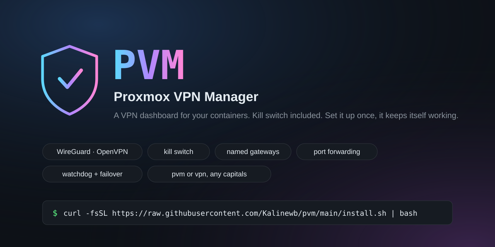
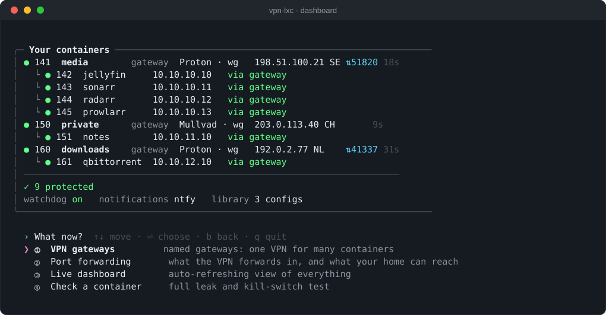
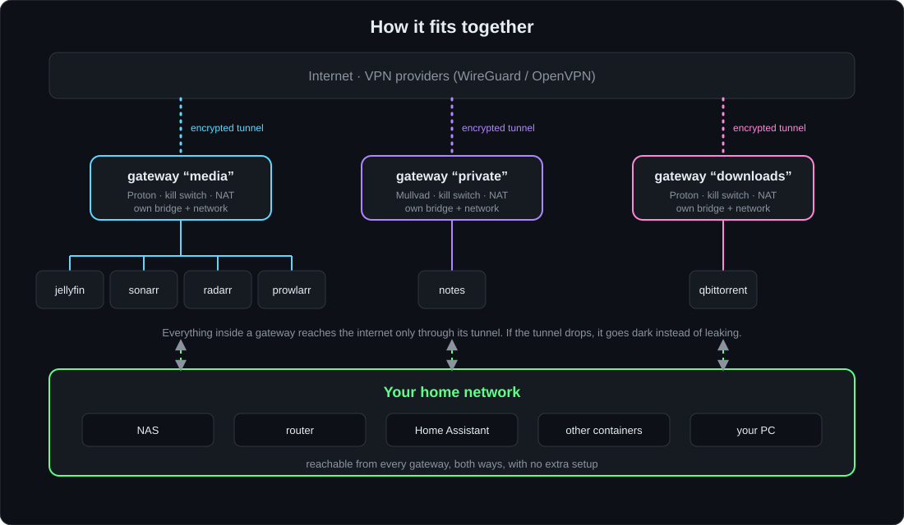
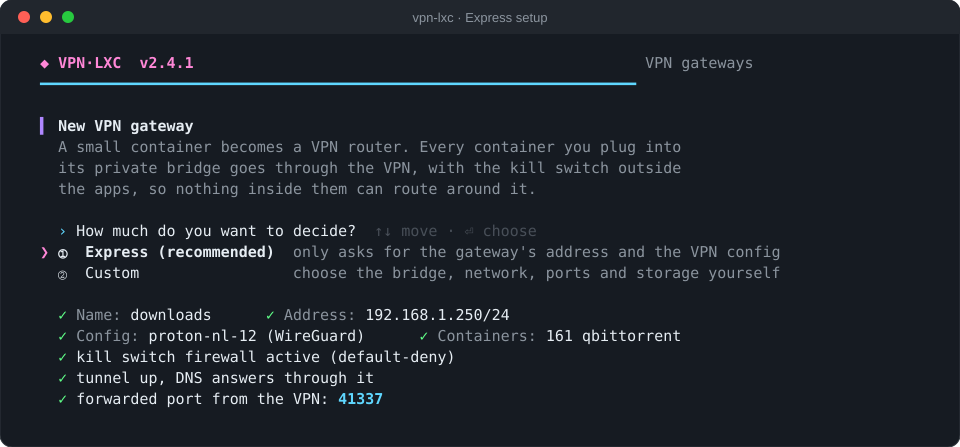

<p align="center"></p>

**vpn-lxc** puts Proxmox containers behind a VPN, with a kill switch, from a simple dashboard you drive with the arrow keys.
WireGuard or OpenVPN, any provider (Mullvad, Proton, AirVPN, others). Set it up once; it keeps itself working.

<p align="center"></p>

## Install

Run on the Proxmox host as root:

```bash
curl -fsSL https://raw.githubusercontent.com/Kalinewb/vpn-lxc/main/install.sh | bash
```

Then start it with `vpn-lxc`. Keep it current with `vpn-lxc update` (`vpn-lxc update --check` only looks).
The installer downloads one file and checks its SHA-256 against `dist/vpn-lxc.sh.sha256` before installing to `/usr/local/sbin/vpn-lxc`.
Uninstall: `curl -fsSL https://raw.githubusercontent.com/Kalinewb/vpn-lxc/main/install.sh | bash -s -- --uninstall`.
Prefer to read it first? The whole tool is [`dist/vpn-lxc.sh`](dist/vpn-lxc.sh).

Requirements: Proxmox VE (developed and tested on 9.x), containers running Debian or Ubuntu, and a WireGuard or OpenVPN config per connection from your provider.

## How it fits together

<p align="center"></p>

* **VPN gateways** – a small container holds one tunnel; containers on its private bridge go through it. Make as many as you like and name them (`media`, `private`, `downloads`...). One gateway is one VPN connection, however many containers sit behind it.
* **Protect containers** – a container runs its own tunnel and kill switch, no gateway needed.
* **One connection, one config.** A config (a WireGuard key, or an OpenVPN server list) that is already in use by one gateway or container is never offered for another, even in a later session, because a WireGuard key holds only one session.

<p align="center"></p>

Both modes ask **Express** (default: just the VPN config and, for a gateway, a name and address) or **Custom**.

## What you get by default

* Your home network is never behind the VPN: full access both ways. DNS to the LAN (53/853) is blocked so lookups can't leak around the tunnel.
* Everything else leaves only through the tunnel. IPv6 is blocked. If the tunnel drops, traffic stops instead of leaking.
* The kill switch loads before the network and survives reboots. A watchdog restarts the tunnel, fails over to a backup config, and tells you (ntfy / Gotify).
* **Port forwarding menu**, per gateway: the port your provider forwards (NAT-PMP or fixed) and which container gets it, plus which container ports your home network can reach. qBittorrent's listening port is kept in sync. Changes reload the firewall only; the VPN stays connected.
* Apps like qBittorrent or the *arr suite can optionally be stopped while the VPN is down and started again when it's back (a yes/no per container).

## Use

    vpn-lxc              dashboard + menu (arrow keys, Enter; b = back, q = quit)
    vpn-lxc dashboard    print the dashboard once
    vpn-lxc live         auto-refreshing dashboard
    vpn-lxc status 126   full leak / kill-switch check of one container
    vpn-lxc switch 126 backup
    vpn-lxc watchdog     one watchdog round (a systemd timer runs this every 2 minutes)
    vpn-lxc update       install the latest version
    vpn-lxc version

## Layout

    src/*.sh           host-side code, in load order
    src/payload/       scripts and units that run inside the containers
    build.sh           joins everything into dist/vpn-lxc.sh (the file you install)
    check.sh           syntax + ShellCheck + build
    tests/unit.sh      function-level tests (run on a Proxmox host so nft can check the firewalls)
    tests/drive.py     drives the full-screen app in a pseudo terminal
    tests/fake-*.py    stand-ins for ntfy/Gotify and the qBittorrent WebUI
    docs/              the pictures above (docs/make-art.py regenerates them; all sample data)

Edit `src/`, never `dist/`. Run `./check.sh && sudo bash tests/unit.sh dist/vpn-lxc.sh`, then `./build.sh` before committing.

## License

MIT
